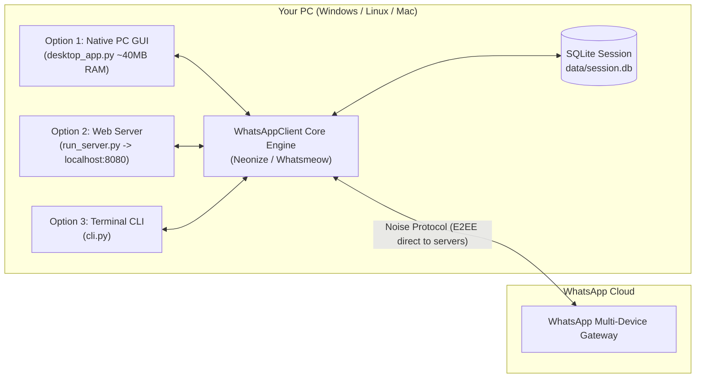

# 💻 WhatsApp Lite Client (PC Desktop & Web)

> A lightweight, resource-efficient WhatsApp Multi-Device client designed for your **PC** to connect to WhatsApp without the heavy official desktop app (~800MB Electron) and without needing your phone to stay awake or connected.

---

## 🌟 Why WhatsApp Lite for PC?

The official WhatsApp Desktop app is an Electron app that consumes **600 MB – 1.2 GB of RAM**, and running WhatsApp Web in a browser tab is similarly memory-intensive. Moreover, legacy WhatsApp clients required your phone to remain constantly powered on and connected to the internet.

**WhatsApp Lite** connects your **PC directly to WhatsApp's Multi-Device network** as an independent companion client:
- 💻 **Featherweight PC Desktop App**: Consumes only **~40 MB of RAM** with a native dark-mode GUI (`desktop_app.py`).
- 🔋 **Zero Phone Drain**: After 1-time pairing, your phone does **not** need to remain online or awake. Your PC communicates with WhatsApp servers autonomously.
- 🔑 **One-Time Pairing**: Pair once using an 8-character code or QR code. Credentials are saved locally in SQLite (`data/session.db`)—**no repeated logins**.
- 🌐 **Web & Mobile Friendly**: Also includes a FastAPI web client (`run_server.py`) and a full terminal CLI (`cli.py`).

---

## 🏗️ Architecture



---

## 🚀 Quick Start Guide

### 1. Prerequisites
- Python 3.10+ installed
- Git installed
- An active WhatsApp account on your primary phone (only needed once to approve linking)

### 2. Installation

Clone this repository and set up a virtual environment:

```bash
git clone https://github.com/LuigiLuigi2401/whatsapp-client.git
cd whatsapp-client

# Create and activate virtual environment
python -m venv venv

# Windows:
.\venv\Scripts\activate
# Linux / macOS:
source venv/bin/activate

# Install dependencies
pip install -r requirements.txt
```

---

## 📲 How to Use on Your PC

### Option 1: Native PC Desktop App (Recommended)

Launch the native Windows/Linux dark-mode desktop GUI:

```bash
python desktop_app.py
```

- **Features**:
  - Extremely light on memory (**~40 MB RAM** vs ~800 MB for official WhatsApp Desktop).
  - Clean WhatsApp dark mode aesthetic with instant messaging.
  - **One-Click Link**: Click **🔗 Link Device** in the toolbar to either scan the QR code or enter your phone number to get an 8-character pairing code.
  - Once linked, the session is saved permanently in `data/session.db`. When you close and reopen the app, it reconnects automatically.
  - **Your phone does NOT need to remain online or awake.**

---

### Option 2: Local Web Dashboard on PC / Browser

If you prefer using your PC's browser (or accessing it from another device on your network):

```bash
python run_server.py
```

Then open `http://localhost:8080` in your browser.

---

### Option 3: Command Line Interface (CLI)

You can also control the client directly from your terminal:

```bash
# Check current session and connection status
python cli.py status

# Link device by scanning QR in terminal
python cli.py login

# Link device using an 8-character phone pairing code
python cli.py pair +1234567890

# Send a message to a phone number
python cli.py send +1234567890 "Hello from lightweight WhatsApp CLI!"

# Stream incoming messages in real-time
python cli.py listen
```

---

## 📁 Project Structure

```
whatsapp-client/
├── data/                  # SQLite session storage (ignored by git for security)
│   └── session.db
├── src/
│   ├── compat.py          # Python <= 3.10 typing compatibility layer
│   ├── config.py          # Configuration and environment variables
│   ├── client.py          # Core WhatsApp Multi-Device client manager
│   ├── handlers.py        # Message parsing, store, and event dispatch
│   └── server.py          # FastAPI REST & WebSocket server
├── web/
│   ├── index.html         # Responsive mobile-first interface
│   ├── style.css          # WhatsApp dark theme styling
│   ├── app.js             # WebSocket client & chat management
│   ├── manifest.json      # PWA metadata for "Add to Home Screen"
│   └── sw.js              # Service Worker for offline shell caching
├── cli.py                 # Interactive CLI tool
├── run_server.py          # Main server entrypoint
├── requirements.txt       # Pinned dependencies
├── .gitignore             # Credential and cache exclusions
└── README.md              # Documentation & architecture guide
```

---

## 🔒 Security & Privacy Notice

- **Session Encryption**: WhatsApp Multi-Device uses end-to-end Signal Protocol encryption. Your private keys are stored exclusively in your local `data/session.db` file.
- **Never Commit `data/` or `*.db`**: These files contain your session tokens. The included `.gitignore` protects them by default.
- **Keep Your Host Secure**: If hosting on a public VPS, use HTTPS, authentication, or a private VPN (like Tailscale) to prevent unauthorized access to your web client.

---

## 📜 License

MIT License. Free for personal and educational use.
