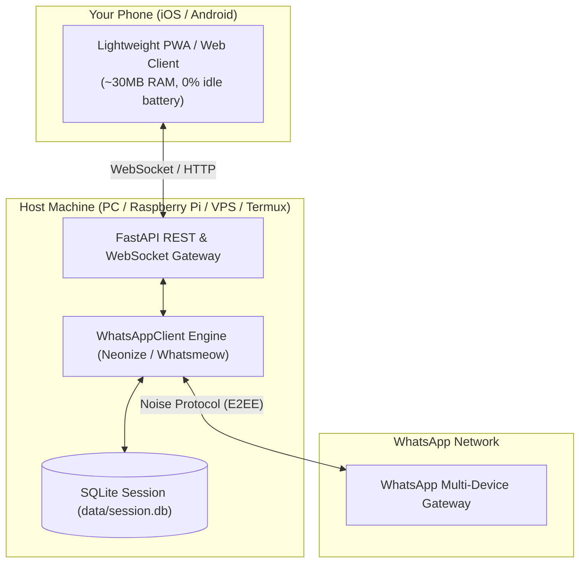

# 📱 WhatsApp Lite Client

> A lightweight, resource-efficient WhatsApp Multi-Device client designed for mobile phones and low-spec environments. Say goodbye to the heavy, resource-draining official app without having to constantly re-login.

---

## 🌟 Why WhatsApp Lite?

The official WhatsApp mobile app runs continuous background sync services, heavy database indexing, and uncompressed media caches that frequently consume **500 MB – 1.2 GB of RAM** and drain battery life.

**WhatsApp Lite** provides an alternative architecture using WhatsApp's native **Multi-Device Protocol**:
- 🔑 **One-Time Pairing**: Pair once via QR Code or an 8-character phone pairing code. Credentials are encrypted and persisted locally in SQLite—**no repeated logins**.
- 🪶 **Ultra-Featherweight**: Consumes under **35 MB of RAM** on your phone (runs inside the browser engine or standalone PWA).
- 🔋 **Zero Idle Battery Consumption**: When the PWA is closed on your phone, background CPU/battery drain is 0%.
- 📲 **Native App Feel**: Install as a **Progressive Web App (PWA)** to your iOS or Android home screen with dark mode and real-time WebSocket messaging.
- 💻 **Cross-Platform & CLI**: Includes both a mobile-first Web interface and an interactive CLI for terminal enthusiasts.

---

## 🏗️ Architecture



---

## 🚀 Quick Start Guide

### 1. Prerequisites
- Python 3.10+ installed
- Git installed
- An active WhatsApp account on your primary phone (only needed once to approve linking)

### 2. Installation

Clone this repository and set up a virtual environment:

```bash
git clone https://github.com/LuigiLuigi2401/whatsapp-client.git
cd whatsapp-client

# Create and activate virtual environment
python -m venv venv

# Windows:
.\venv\Scripts\activate
# Linux / macOS:
source venv/bin/activate

# Install dependencies
pip install -r requirements.txt
```

---

## 📲 How to Use

### Option 1: Launch the Mobile Web / PWA Client (Recommended)

Start the server:
```bash
python run_server.py
```

The server starts on `http://0.0.0.0:8080`.

#### Accessing from Your Phone:
1. **On Local Wi-Fi**:
   - Find your computer's local IP address (`ipconfig` on Windows or `ifconfig` on Linux/Mac, e.g. `192.168.1.15`).
   - Open Safari or Chrome on your phone and go to: `http://192.168.1.15:8080`
2. **Pair Your Phone**:
   - Tap **Link Your Phone** in the web interface.
   - Choose **QR Code** (scan with WhatsApp &rarr; Linked Devices &rarr; Link a Device), OR
   - Choose **Pairing Code** (enter your phone number, e.g., `+1234567890`, and type the 8-character code prompted on your phone).
3. **Install to Home Screen (PWA)**:
   - **iOS (Safari)**: Tap the **Share** button &rarr; **Add to Home Screen**.
   - **Android (Chrome)**: Tap the three dots menu &rarr; **Install App** or **Add to Home Screen**.
   - The app now launches in full-screen standalone mode just like a native app!

---

### Option 2: Remote Access from Anywhere (Without Port Forwarding)

To access your WhatsApp client outside your home Wi-Fi securely:

- **Tailscale (Recommended)**:
  Install [Tailscale](https://tailscale.com) on your host PC and phone. Access the web client securely using your host's 100.x.y.z Tailscale IP.
- **Cloudflare Tunnel**:
  Run `cloudflared tunnel --url http://localhost:8000` to get a free, secure HTTPS URL to open on your phone.

---

### Option 3: Command Line Interface (CLI)

You can also control the client directly from your terminal:

```bash
# Check current session and connection status
python cli.py status

# Link device by scanning QR in terminal
python cli.py login

# Link device using an 8-character phone pairing code
python cli.py pair +1234567890

# Send a message to a phone number
python cli.py send +1234567890 "Hello from lightweight WhatsApp CLI!"

# Stream incoming messages in real-time
python cli.py listen
```

---

## 📁 Project Structure

```
whatsapp-client/
├── data/                  # SQLite session storage (ignored by git for security)
│   └── session.db
├── src/
│   ├── compat.py          # Python <= 3.10 typing compatibility layer
│   ├── config.py          # Configuration and environment variables
│   ├── client.py          # Core WhatsApp Multi-Device client manager
│   ├── handlers.py        # Message parsing, store, and event dispatch
│   └── server.py          # FastAPI REST & WebSocket server
├── web/
│   ├── index.html         # Responsive mobile-first interface
│   ├── style.css          # WhatsApp dark theme styling
│   ├── app.js             # WebSocket client & chat management
│   ├── manifest.json      # PWA metadata for "Add to Home Screen"
│   └── sw.js              # Service Worker for offline shell caching
├── cli.py                 # Interactive CLI tool
├── run_server.py          # Main server entrypoint
├── requirements.txt       # Pinned dependencies
├── .gitignore             # Credential and cache exclusions
└── README.md              # Documentation & architecture guide
```

---

## 🔒 Security & Privacy Notice

- **Session Encryption**: WhatsApp Multi-Device uses end-to-end Signal Protocol encryption. Your private keys are stored exclusively in your local `data/session.db` file.
- **Never Commit `data/` or `*.db`**: These files contain your session tokens. The included `.gitignore` protects them by default.
- **Keep Your Host Secure**: If hosting on a public VPS, use HTTPS, authentication, or a private VPN (like Tailscale) to prevent unauthorized access to your web client.

---

## 📜 License

MIT License. Free for personal and educational use.
